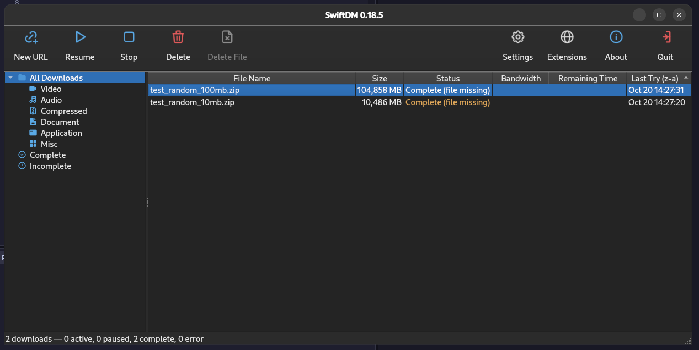
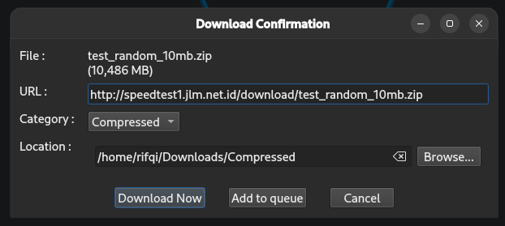
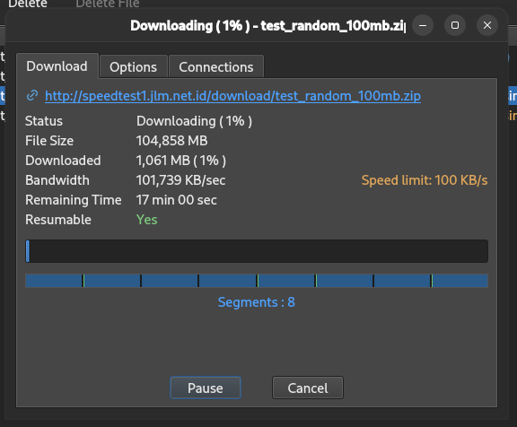
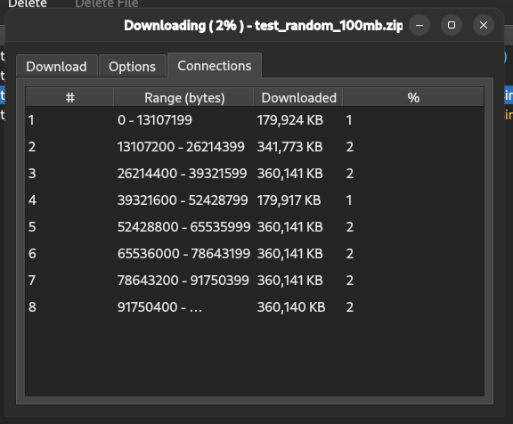
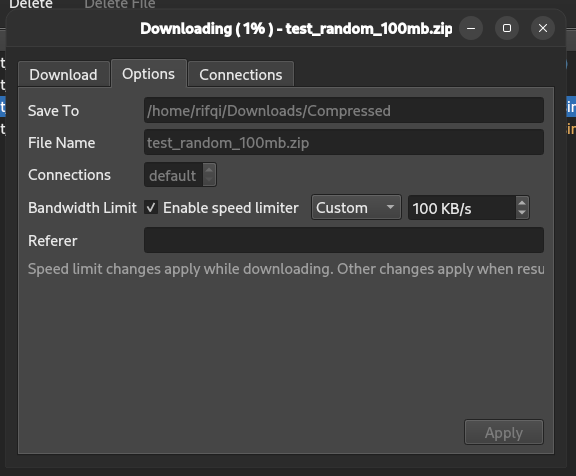
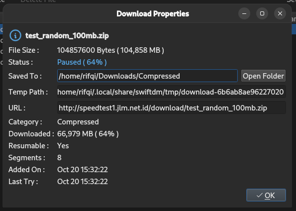
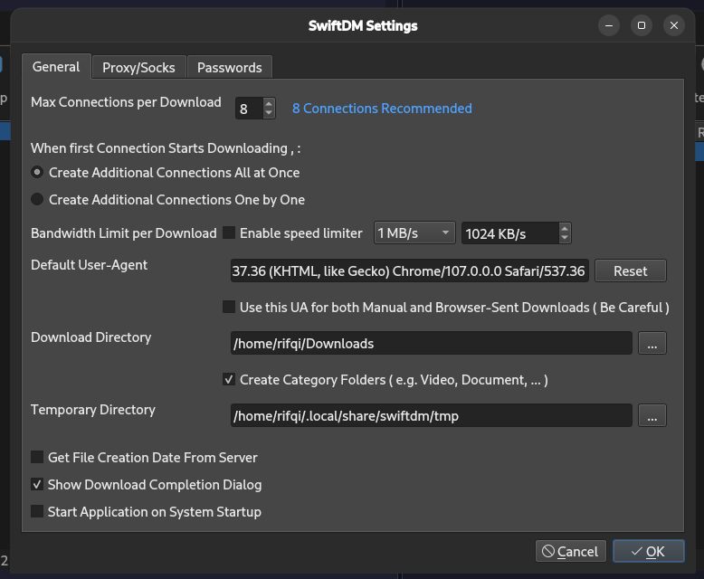

# SwiftDM

[](https://github.com/LuckyPicky354/swift-download-manager/actions/workflows/ci.yml)

SwiftDM is a desktop download manager for Linux. It supports segmented
downloads, pausing and resuming transfers, and both graphical and command-line
interfaces. SwiftDM is built with C++20, Qt 6, libcurl, and SQLite.

This project is a clean-room implementation based on behavioral specifications
documented in [`docs/spec/`](docs/spec/). No code, assets, icons, or branding are
taken from the application used as a behavioral reference.

## Screenshots



| Download confirmation | Download progress | Connection segments |
|---|---|---|
|  |  |  |

| Download options | Download properties | Application settings |
|---|---|---|
|  |  |  |

> The settings screenshot still shows the window of 0.18.9 (three tabs). Since
> 0.18.10 the window has the tabs `General`, `Interface`, `Download`,
> `Proxy/Socks` and `Passwords`; since 0.18.20 each tab groups its options into
> labeled sections.

## Features

- Download over HTTP, HTTPS, FTP, FTPS, and HLS playlists (`.m3u8`).
- Split HTTP/HTTPS downloads across multiple connections; configure the
  connection count.
- Pause, resume, and restore downloads after restarting the application.
- Organize downloads by category and destination folder; view progress, speed,
  estimated time remaining, and active connections/segments.
- Configure global and per-download speed limits, including changing the limit
  while a transfer is running.
- Use HTTP, SOCKS4, or SOCKS5 proxies; configure HTTP headers, cookies, referer,
  User-Agent, and POST data.
- Store download history in SQLite and application settings in an INI file.
- Handle long file names: a name that does not fit the filesystem is shortened
  automatically, keeping the beginning of the name and its extension.
- Adjust the appearance: light, dark, or follow the system theme; toolbar size
  and toolbar text; simple or colorful tray icon. The changes apply right away.
  The message boxes use the app's own icons instead of the platform ones.
- Download from the command line without opening the GUI.
- Preview integration with the Chromium extension: send links or pages,
  intercept HTTP(S) downloads, and detect playlists/media pairs.
- Browser download confirmations appear while link metadata is checked; the
  initial transfer reuses that probe instead of repeating network checks.
- Resolve supported Google Drive download link formats.

> Note: queue scheduling, a Firefox extension, and muxing paired audio/video
> tracks are not available yet. The Chromium extension is a development preview.
> See the [parity checklist](docs/spec/06-parity-checklist.md) for feature
> status and limitations.

## Running SwiftDM

After installation, launch the graphical application from your desktop menu or
run:

```sh
swiftdm
```

To run the freshly built application, use `./build/swiftdm`. The GUI starts by
default. When you add a URL in the GUI, SwiftDM checks the link and shows a
confirmation dialog before starting the download.

SwiftDM also provides a headless CLI:

```sh
swiftdm get <url>
```

For example, set the output directory, filename, and a 1.5 MB/s speed limit:

```sh
swiftdm get 'https://example.org/file.zip' \
  --dir ~/Downloads --name file.zip --limit 1500
```

Other CLI options include `--connections`, `--no-resume`, `--referer`,
`--header`, `--ua`, `--post`, `--config`, `--quiet`, and `--log-level`. For a
complete list, run:

```sh
swiftdm --help
swiftdm --version
```

## Building from source

Debian 13 (trixie) is the reference platform. Install the dependencies:

```sh
sudo apt install build-essential cmake ninja-build \
  qt6-base-dev qt6-svg-plugins libqt6svg6 \
  libcurl4-openssl-dev libsqlite3-dev
```

`qt6-svg-plugins` is required to load SVG icons at runtime.

Configure and build:

```sh
cmake -S . -B build -G Ninja -DCMAKE_BUILD_TYPE=Release
cmake --build build
```

Run the backend/unit and integration tests:

```sh
ctest --test-dir build --output-on-failure
```

CI runs the same build and test sequence on Debian 13 for pull requests and
pushes to `main`. Pushing a `vX.Y.Z` tag publishes the matching `.deb` package
to GitHub Releases; the release checklist is in [`AGENTS.md`](AGENTS.md).

Run the build:

```sh
./build/swiftdm                 # GUI
./build/swiftdm get <url>       # headless CLI
```

### Installing

Create a Debian package with CPack:

```sh
cd build
cpack
sudo apt install ./swiftdm_0.18.22_amd64.deb
```

Alternatively, install using the CMake install rules:

```sh
sudo cmake --install build --prefix /usr/local
```

The package installs the executable, desktop launcher, icons, AppStream
metadata, and Chromium extension source. It does not install a browser; load the
extension in any Chromium-based browser. See
[`packaging/README.md`](packaging/README.md) for more packaging details.

## Application data

By default, SwiftDM stores its configuration in
`~/.config/swiftdm/swiftdm.ini`, download history in
`~/.local/share/swiftdm/swiftdm.db`, and temporary download workspaces in
`~/.local/share/swiftdm/tmp`. These locations follow the XDG environment
variables.

## License and attribution

SwiftDM is licensed under the [Apache License 2.0](LICENSE).

Some user-interface icons are from **Tabler Icons** by Tabler. Tabler Icons are
licensed under the MIT License. Thanks to the Tabler contributors for creating
and maintaining these icons.

- Website: <https://tabler.io/icons>
- Repository and license text: <https://github.com/tabler/tabler-icons>
- Tabler Icons license: <https://github.com/tabler/tabler-icons/blob/main/LICENSE>

## Documentation

- [Specifications and feature status](docs/spec/06-parity-checklist.md)
- [Chromium extension guide](ext/chromium/README.md)
- [Packaging guide](packaging/README.md)
- [Changelog](CHANGELOG.md)
